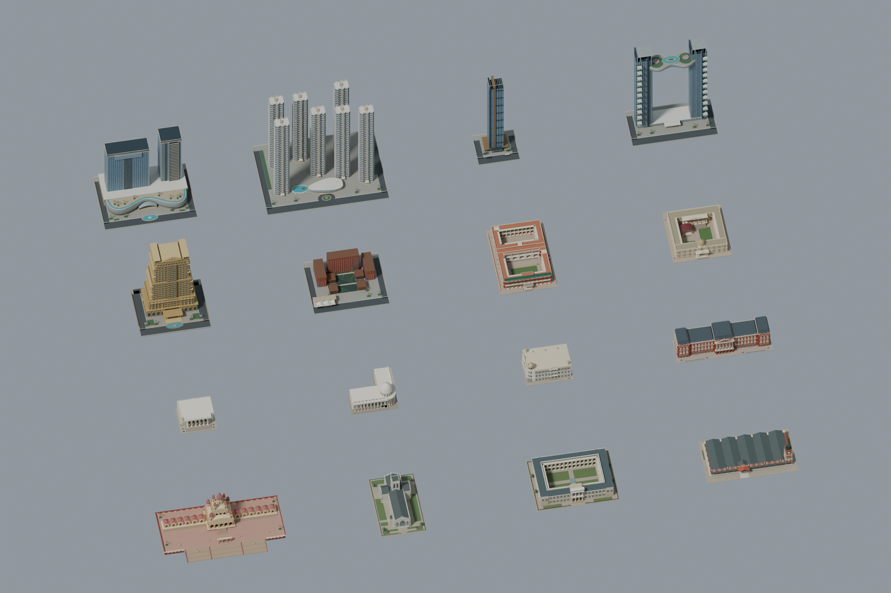

# Tier 1 master showcase

Open [Kolkata_Tier1_Staging.blend](Kolkata_Tier1_Staging.blend) for the complete
16-landmark staging scene. Each numbered collection has its own ground-origin
pivot and original modular source hierarchy, with foundations and grounds.
Geometry, linked repeats, material graphs and UVs are preserved; all five
material images are packed. Move a `PIVOT | …` to reposition a whole landmark.



The [final export packages and import guidance](../../../exports/kolkata_tier1_staging/README.md)
contain 131 default modular FBXs and the optional Shiva master. The
[export manifest](export-manifest.json) records sources, hashes, local/staging
transforms, dimensions, dependencies and module counts; the
[essential check report](validation.json) records the verified result.

This is a 4×4 inspection grid with at least 218 studs between footprints.
It is not the final city. Source masters remain unchanged and authoritative;
Studio has not been modified. Presentation lights/camera are separate from exports.

Reproduce from the repo root with Blender 5.2:

```powershell
& 'C:\Program Files\Blender Foundation\Blender 5.2\blender.exe' --background --python-exit-code 1 --python assets/kolkata/tier1_showcase/build.py
& 'C:\Program Files\Blender Foundation\Blender 5.2\blender.exe' --background --python-exit-code 1 --python assets/kolkata/tier1_showcase/verify.py
python assets/kolkata/tier1_showcase/package.py
```

For one deliberately edited staging asset, run `reexport.py -- KOL_T1_ASSET_ID`
with Blender's `--python` argument. Output goes to that asset's `reexported/`
folder, at its original local origin; the completed packages are not overwritten.
